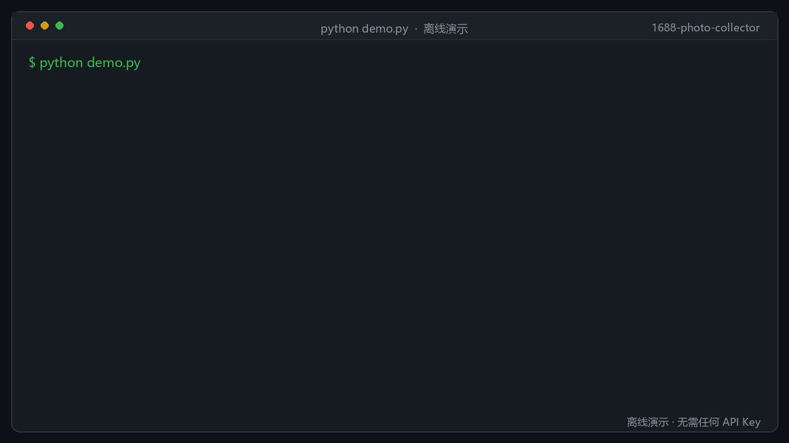
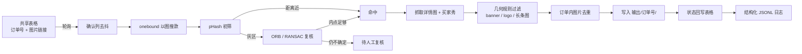

# 1688 实拍图自动采集

把「客户发来一张实拍图 → 在 1688 找到同款 → 按卖家收集详情图/买家秀 → 按订单归档」这条人工流程做成可无人值守的采集服务。

运营在共享表格里填一行订单号 + 图片链接，打勾确认后，程序自动完成搜款、图像比对、去重、下载、过滤和状态回写。适合电商视觉素材收集、同款比价、供应商找款等场景。

> 仓库内的示例数据均为合成数据；本仓库不包含任何真实客户图片、订单或 API 凭证。
>
> 许可证：[MIT](LICENSE)，可自由使用、修改、分发和商用，保留版权声明即可。



*离线演示：`python demo.py`，不需要任何 API Key。*

## 业务流程



## 核心能力

- **以图搜款**：调用 onebound 的 1688 图片搜索接口，按销量排序扫描候选商品。
- **两阶段图像匹配**：pHash 处理原图搬运、缩放、压缩；pHash 落在灰区时用 ORB + RANSAC 内点判定，抗裁剪、换背景。
- **三档决策**：`HIT` / `REVIEW` / `MISS` 三档输出，不确定的样本进入 `复核/`，不静默误采。
- **订单级去重缓存**：SQLite 保存图片指纹，同一张客户图再次提交时直接复用已有文件夹。
- **垃圾图过滤**：按尺寸与长宽比过滤 banner、logo、长条图，降低人工筛选成本。
- **多表格后端**：钉钉在线表格、飞书多维表格、金山文档、本地 xlsx 共用一套接口。
- **可观测**：每个订单写入 JSONL 事件；日志中的 token / key / secret 自动脱敏。
- **单实例保护**：文件锁 + 僵死 PID 回收，避免定时任务与手动启动重复跑同一张表。
- **失败重试**：区分配额耗尽、瞬时网络错误和业务错误，分别暂停、重试或标记错误。

## 快速开始

### 1. 离线演示（无需任何凭证）

```bash
python -m venv .venv
# Windows
.venv\Scripts\activate
# macOS / Linux
source .venv/bin/activate

pip install -r requirements.txt
python demo.py
```

`demo.py` 会生成一张示例 xlsx 表格并跑一轮监听，演示确认列触发、状态回写和日志落盘。输出末尾会打印回写后的表格内容。

### 2. 接入真实表格

```bash
cp config.example.yaml config.yaml   # 填入自己的凭证
python watcher.py                    # 前台轮询
```

也可以不建 `config.yaml`，只注入环境变量：

```bash
cp .env.example .env                 # 填入自己的凭证
```

环境变量优先级高于 `config.yaml`，适合 Docker / CI / 服务器部署。

### 3. Docker（无头模式）

```bash
mkdir -p config data
cp config.example.yaml config/config.yaml   # 填好后挂载，只读
docker compose up -d --build
docker compose logs -f
```

镜像只包含采集核心，**不包含** Windows 桌面控制台（`console.py`）与系统托盘。GUI 依赖见 `requirements-gui.txt`。

## 3 分钟填 Key

仓库只提交 `config.example.yaml` 和 `.env.example`，没有任何真实凭证。

### 方式 A：config.yaml（本机推荐）

```bash
cp config.example.yaml config.yaml
```

至少填 onebound：

```yaml
api:
  provider: onebound
  base_url: "https://api-gw.onebound.cn"
  key: "你的 onebound key"
  secret: "你的 onebound secret"
```

表格后端按需选择：

```yaml
sheet:
  backend: "xlsx"     # 本地 xlsx：不需要表格凭证
  # backend: "dingtalk"
  # backend: "feishu"
  # backend: "wps"
```

- `xlsx`：填 `sheet.xlsx.path`，指向本地表格即可
- `dingtalk`：填 `sheet.dingtalk.app_key` / `app_secret` / `workbook_id` / `sheet_id` / `operator_id`
- `feishu`：填 `sheet.feishu.app_id` / `app_secret` / `app_token` / `table_id`
- `wps`：填 `sheet.wps.app_id` / `app_secret` / `access_token` / `file_token`

### 方式 B：环境变量（Docker / CI / 服务器推荐）

```bash
cp .env.example .env
```

Docker Compose 会读取 `.env`；本地直接运行 `python ...` 不会，需要先手动设置环境变量。PowerShell 示例：

```powershell
$env:ONEBOUND_API_KEY="你的 key"
$env:ONEBOUND_API_SECRET="你的 secret"
python watcher.py
```

环境变量优先级高于 `config.yaml`。

### 最小填写组合

| 你要做的事 | 最少需要 |
| --- | --- |
| 离线演示 `python demo.py` | 不需要任何 Key |
| 真实以图搜款 | onebound `key` + `secret` |
| 本地 xlsx 表格 | 不需要表格凭证 |
| 钉钉 / 飞书 / WPS | 对应平台的应用凭证 |

填完先验证：

```bash
python demo.py
python watcher.py
```

`watcher.py` 会真实调用 onebound；建议先用小批量订单或测试表格验证。

## 配置

配置分为三层，后者覆盖前者：

1. 代码默认值
2. `config.yaml`（本地开发）
3. 环境变量（CI / Docker / 服务器）

主要环境变量：

| 变量 | 对应配置 | 说明 |
| --- | --- | --- |
| `COLLECTOR_CONFIG` | — | 配置文件路径，默认 `config.yaml` |
| `ONEBOUND_BASE_URL` | `api.base_url` | onebound 网关 |
| `ONEBOUND_API_KEY` | `api.key` | 图片搜索 API Key |
| `ONEBOUND_API_SECRET` | `api.secret` | 图片搜索 API Secret |
| `DINGTALK_APP_KEY` / `DINGTALK_APP_SECRET` | `sheet.dingtalk` | 钉钉企业内部应用 |
| `FEISHU_APP_ID` / `FEISHU_APP_SECRET` | `sheet.feishu` | 飞书自建应用 |
| `WPS_APP_ID` / `WPS_APP_SECRET` / `WPS_ACCESS_TOKEN` | `sheet.wps` | 金山文档 |
| `COLLECTOR_WORK` | `paths.work` | 临时目录、状态、锁文件 |
| `COLLECTOR_OUTPUT` | `paths.output` | 订单输出根目录 |
| `COLLECTOR_CACHE` | `paths.cache` | 去重缓存 SQLite |
| `COLLECTOR_LOG` | `paths.log` | JSONL 日志目录 |
| `COLLECTOR_REVIEW` | `paths.review` | 人工复核目录 |

完整字段见 [`config.example.yaml`](config.example.yaml)。

## 测试

```bash
pip install -r requirements-dev.txt
python -m pytest
```

测试覆盖配置加载与脱敏、API 响应解析、pHash/ORB 匹配与三档决策、去重、垃圾图过滤、表格读写、批处理路径安全、单实例锁和日志脱敏。

GitHub Actions 在 Python 3.10 / 3.12 上运行测试，并额外执行一次离线演示和 Docker 构建冒烟测试。

## 目录结构

```text
.
├── watcher.py          # 轮询、去抖、状态机、错误分类
├── pipeline.py         # 单订单处理流程：搜款 → 匹配 → 下载 → 过滤 → 归档
├── api_client.py       # onebound 接口适配与错误脱敏
├── matcher.py          # pHash + ORB/RANSAC
├── dedup.py            # 图片指纹与缓存复用
├── store.py            # SQLite 去重缓存
├── junk_filter.py      # banner / logo / 长条图过滤
├── sheets.py           # 钉钉 / 飞书 / 金山 / xlsx 后端
├── review.py           # 人工复核
├── learn.py            # 用复核结果保守标定 ORB 阈值
├── obs.py              # JSONL 结构化日志与统计
├── config.py           # YAML + 环境变量 + 密钥脱敏
├── runlock.py          # 单实例文件锁
├── console.py          # Windows 桌面控制台（不进入 Docker）
├── demo.py             # 离线演示
├── docs/demo.gif       # 离线演示 GIF
└── tests/              # pytest
```

## 安全设计

- 仓库只提交 `config.example.yaml` 与 `.env.example`，真实配置被 `.gitignore` 排除。
- 支持纯环境变量运行，密钥无需落盘。
- `save_config` 默认剥离敏感字段，只有显式设置 `COLLECTOR_PERSIST_SECRETS=1` 才写回。
- 异常、URL 和日志统一经过 `redact_text`，避免 key / secret / token 进入日志或工单。
- 原始 API 返回落盘前会做同样的脱敏处理。

## 已知限制

- 图像匹配阈值需要按品类用真实数据标定；仓库中的默认值是试点参考值。
- 共享表格的「状态列」是协作锁，不是分布式锁；多机部署时应只指定一台服务机。
- 买家秀接口默认关闭，避免不必要的调用成本。
- 桌面控制台依赖 Windows / tkinter，未纳入 CI 和 Docker。

## Roadmap

- [ ] 把表格后端抽成正式插件接口，补充飞书/金山契约测试
- [ ] 用真实标注集输出匹配准确率与召回率报表
- [ ] 增加 Prometheus 指标与失败告警
- [ ] 增加采集结果的缩略图预览页

## License

本项目采用 [MIT License](LICENSE)。

你可以自由使用、修改、分发和商用，只需保留版权声明与许可证声明。代码按“现状”提供，不附带任何担保。
